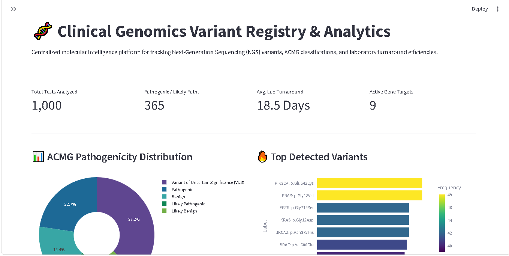
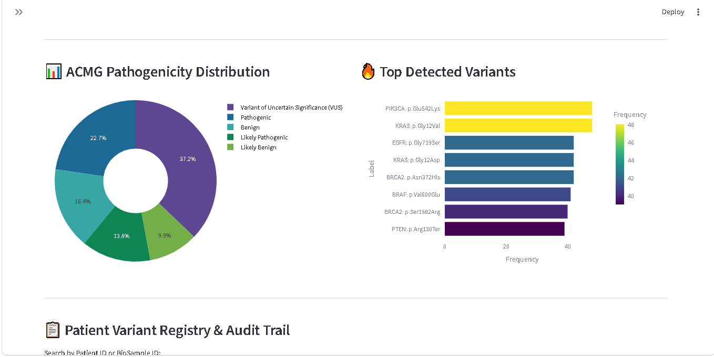
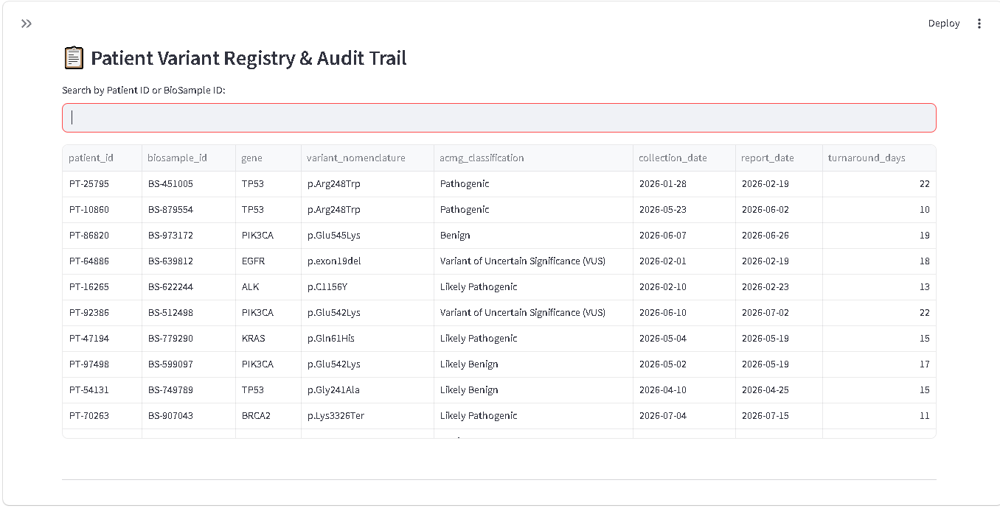

# 🧬 Clinical Genomics Variant Registry & Analytics

A clinical-grade registry and operational intelligence platform designed for Genetic Counselors, Clinical Laboratory Directors, and Molecular Biologists to search patient genetic records, analyze ACMG pathogenicity distributions, and optimize Next-Generation Sequencing (NGS) turnaround times.

---

## 📊 Dashboard Preview
![Clinical Genomics Dashboard Preview]




> **Live Interactive Demo:** *[Insert Streamlit Cloud Link Here]*

---

## 🎯 The Problem & Business Impact

As genetic testing becomes increasingly accessible, clinical laboratories generate massive volumes of genomic variant data. However, reliance on static PDF reports and disorganized spreadsheets creates three major operational bottlenecks:

1. **Data Silos:** Clinicians struggle to quickly search specific patient variants or cross-reference multi-gene panels without a centralized database.
2. **Obscured Variant Prevalence:** Labs lack visibility into population-specific frequencies of pathogenic mutations across key cancer and cardiovascular genes.
3. **Operational Delays:** Without tracking, complex sequencing workflows (like Panels or Whole Exome Sequencing) can suffer from prolonged turnaround times, delaying critical genetic counseling and patient care.

---

## 💡 The Solution

This platform transforms raw Next-Generation Sequencing (NGS) reports into actionable clinical intelligence. By uniting localized SQLite database queries, dynamic ACMG classification breakdowns, variant search registries, and turnaround time monitoring, the system enables genetic laboratories to bridge the gap between raw genomic data and clinical application.

---

## 🚀 Key Features

### 1. Interactive Patient Variant Registry
* **Searchable Clinical Database:** Core data table allowing geneticists to look up specific Patient IDs or BioSample IDs instantly.
* **Granular Gene & Variant Filters:** Isolate specific genes (e.g., `BRCA1`, `TP53`, `EGFR`) and inspect exact variant nomenclature (e.g., `p.Cys61Gly`).

### 2. Pathogenicity Distribution (ACMG Classification)
* **Clinical Significance Breakdown:** Visualizes the proportion of tests returning *Pathogenic*, *Likely Pathogenic*, *Variant of Uncertain Significance (VUS)*, or *Benign* results.
* **Standardized Compliance:** Aligns reporting metrics directly with American College of Medical Genetics and Genomics (ACMG) guidelines.

### 3. Top Detected Variants Analysis
* **Population Burden Insights:** Bar charts highlighting the most frequently detected pathogenic variants in the dataset.
* **Epidemiological Support:** Aids lab directors in understanding regional or institutional genetic disease burdens.

### 4. Lab Turnaround Time (TAT) Tracking
* **Workflow Efficiency Metrics:** Tracks the average number of days required to process genetic tests from sample receipt to final verification.
* **SLA Monitoring:** Alerts management if specialized tests breach standard clinical delivery windows.

---

## 🛠️ Technical Architecture & Stack

* **Data Engineering & Simulation:** Python (`pandas`, `numpy`) generating a synthetic dataset simulating 1,000 clinical genetic tests across major oncology and cardiovascular genes.
* **Database Engine:** `SQLite` (`genomics_registry.db`) storing patient metadata, gene nomenclature, and ACMG classifications.
* **Analytics Interface:** `Streamlit` and `Plotly` providing a high-performance, interactive UI.

```text
clinical-genomics-registry/
│
├── app.py                      # Core Streamlit dashboard application
├── generate_genomic_data.py    # Python data generator & SQLite population pipeline
├── requirements.txt            # Python dependencies (streamlit, pandas, plotly)
├── README.md                   # Technical documentation
│
├── data/
│   └── genomics_registry.db    # SQLite database (Synthetic patient variant data)
│
└── screenshots/
    ├── dashboard1.png      # Main dashboard
    ├── dashboard2.png # ACMG & Variant frequency breakdown 
    └── dashboard3.png  # Searchable patient registry 


# 📸 Additional Dashboard Views
1. Pathogenicity & Variant Frequency Analytics
2. Searchable Variant Registry & TAT Logs


# ⚙️ Installation & Local Setup
To run this dashboard locally on your machine:

Clone the repository:

```bash
git clone https://github.com/PageG80/clinical-genomics-registry.git
cd clinical-genomics-registry
```

Initialize the SQLite Database & Generate Data:

```bash
python generate_genomic_data.py
```

Launch the Streamlit Dashboard:

```bash
streamlit run app.py
```